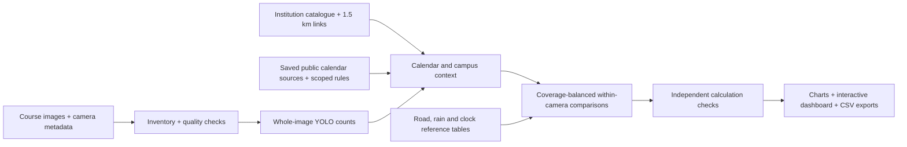

# Bangkok school traffic

We compare visible vehicle counts near Bangkok schools across hours and weekdays/weekends, using 61,319 CCTV snapshots from 100 cameras, collected on 25–31 August 2026.

The main result is a larger weekday morning count in the same camera views: **+61.2%**, compared with **+0.9%** at midday and **+28.7%** in the afternoon, across 89 cameras with sufficient matched coverage. This describes a pattern near schools; it does not measure traffic caused by schools. Read [FINDINGS.md](FINDINGS.md) and [METHODS.md](METHODS.md) for the evidence and limits.

## Clone and run on your laptop

```sh
gh repo clone Panyawat-Phothiphanich/bangkok-cctv-campus-proximity
cd bangkok-cctv-campus-proximity
```

This repository's **main branch is the complete, organized submission**. The saved counts, calendar labels, analysis, figures and dashboard data are included. You can start without downloading the source images or running YOLO.

If GitHub CLI is unavailable or asks you to sign in, the public repository can also be cloned with:

```sh
git clone https://github.com/Panyawat-Phothiphanich/bangkok-cctv-campus-proximity.git
cd bangkok-cctv-campus-proximity
```

## Run it

Install [uv](https://docs.astral.sh/uv/getting-started/installation/), then open a terminal in this folder. Python 3.11 is recommended.

```sh
uv sync --frozen --python 3.11
uv run --frozen python run.py check
uv run --frozen python run.py dashboard
```

Open **http://127.0.0.1:8501**. The dashboard includes camera/date/class filters, maps, time series, school-calendar evidence, quality/coverage information, and CSV downloads. Use `--port 8502` if another app already uses the default port. Installation needs internet; the included study data works offline. Online map tiles have an offline coordinate-view alternative.

## Prompt for ChatGPT or Codex on another laptop

Copy this whole prompt into an agent that can use your laptop's terminal:

```text
Set up and run this Bangkok school-traffic project on this laptop.

Repository: https://github.com/Panyawat-Phothiphanich/bangkok-cctv-campus-proximity

1. Clone the main branch using:
   gh repo clone Panyawat-Phothiphanich/bangkok-cctv-campus-proximity
   If gh is unavailable or not signed in, use:
   git clone https://github.com/Panyawat-Phothiphanich/bangkok-cctv-campus-proximity.git
   If a local copy already exists, check its remote and preserve any uncommitted work.
2. Open the repository folder and read README.md, AGENTS.md, METHODS.md and SOURCES.md.
3. Set up uv if needed, then run from the repository root:
   uv sync --frozen --python 3.11
   uv run --frozen python run.py check
   uv run --frozen pytest -q
4. Use the included completed data. Do not run YOLO, download source images or start
   GPU inference for this setup. Do not alter frozen inputs, quality rules, counts
   or measurement definitions. Whole-image counts include parked vehicles.
5. Start the dashboard:
   uv run --frozen python run.py dashboard
   If port 8501 is occupied, use --port 8502. Open the local URL when a browser is
   available; otherwise give me the URL. Keep the server running while I use it.
6. Fix setup or access problems without changing the study. Report the actual
   test/check results and dashboard URL, plus any unresolved problem.

If I later ask you to reproduce the tables and charts, choose a new empty output
folder and run:
   uv run --frozen python run.py rebuild --output results/rebuilt
   uv run --frozen python run.py check --output results/rebuilt
   uv run --frozen python run.py dashboard --output results/rebuilt
Do not overwrite an existing rebuild. Read the methods before interpreting the
results as a school effect. Use a separate branch for requested edits.
```

## Recreate the results

```sh
uv run --frozen python run.py rebuild --output results/rebuilt
uv run --frozen python run.py check --output results/rebuilt
uv run --frozen python run.py dashboard --output results/rebuilt
uv run --frozen pytest -q
```

Use a new output folder each time. Rebuild preserves existing results and never runs the detector. It checks the saved inputs, adds calendar labels, rebuilds hourly tables/comparisons/seven charts, independently checks the calculations, and prepares dashboard data. The supplied results are already built. All commands also work when invoked with an absolute path to `run.py`; paths resolve from the project folder.

## Folder guide

| Location | Purpose |
|---|---|
| `run.py` | The four commands: `rebuild`, `check`, `dashboard`, `infer` |
| `workflow/calendar.py` | Holiday, term and closure labels, with explicit evidence scopes |
| `workflow/traffic.py` | Coverage gates, balanced comparisons, school-clock cases and peak selection |
| `workflow/analysis.py` | Runs those calculations and writes tables and charts |
| `workflow/verify.py`, `dashboard_bundle.py` | Independent reconciliation and compact dashboard export |
| `workflow/inference.py`, `image_processing/` | Optional intake, quality checks and resumable whole-image inference |
| `dashboard/` | Streamlit interface and filtering/calculation helpers |
| `inputs/` | Frozen counts, campus catalogue, context tables, reviewed calendar rules and source snapshots |
| `results/calendar/` | Calendar-enriched observations and supporting labels |
| `results/analysis/` | Analysis tables, seven figures, summary and verification |
| `results/dashboard/` | Compact dashboard data |
| `tests/` | Calendar, analysis and dashboard checks |

Generated CSVs support inspection and sharing; Parquet preserves types. Camera IDs are strings. The large observation table is supplied once as Parquet rather than duplicating it as CSV. Source/code hashes are recorded in the manifests. [SOURCES.md](SOURCES.md) describes where the inputs came from and which steps include human judgments.

## Optional: process the images again

This is the expensive step. It is separate from `rebuild`, and has not been run again during this cleanup. It uses the original image-intake, quality and detector functions, with the historical boundary-comparison and reviewer interfaces removed from this submission.

1. Obtain the [course archive and metadata](https://drive.google.com/drive/folders/1k2-KxXe4wbDmFGcGXI-pK7TdSXjBHTni). Save them as `data/raw/cctv_images.zip` and `data/raw/cctv_info.csv` under this folder. The archive hash is checked before processing. Camera metadata is [also linked directly here](https://drive.google.com/file/d/1VSCzWeNOV7ds_d9BNJ9i20_9JzyncL2F/view).
2. Obtain the [pinned YOLO26x weights](https://github.com/ultralytics/assets/releases/download/v8.4.0/yolo26x.pt) as `models/yolo26x.pt`. The configured weight hash is checked before processing.
3. Run on an Apple Silicon Mac with adequate free storage and memory:

```sh
uv sync --frozen --extra inference --python 3.11
uv run --frozen --extra inference python run.py infer --output results/new_inference
```

Repeat the same command to resume. SQLite checkpoints reuse successful images, including real zero detections. `--limit 20` caps newly processed unique images for a small trial and produces an explicitly partial table. One process should own each output folder. The configuration is `inputs/image_model.yaml`: MPS, 960-pixel input, batch 1, 30% memory cap, confidence retention 0.10, counting threshold 0.25, IoU 0.5. All five vehicle classes are counted over the **whole image, including parked vehicles**.

A rerun writes `results/new_inference/images/traffic_full_frame.parquet` and its progress/summary; it does not replace the frozen submission counts. Device/runtime changes can affect predictions. Compare and review a rerun before adopting it for a new study. The current frozen calendar rules only cover the seven study dates.

## Method in brief



- Counts are visible sightings per snapshot, not flow, unique vehicles, speed or congestion.
- Excluded/unknown measurements stay missing; successful empty detections are zero.
- The headline compares the same camera and accepted dates in eight fixed hours: 07–09, 10–14 and 15–17. At least three complete weekdays and both weekend days are required.
- Hourly means receive equal weight within each day; days receive equal weight within each day type. The headline is a median of within-camera percentage differences.
- Calendar integration is complete as code; source coverage is partial. Unsupported terms/closures remain unknown. BBA programme evidence is not a university-wide calendar.
- Model accuracy has not been independently established. Human review was deferred. Coordinates, institution types, camera-clock offsets and overlapping views retain their recorded limitations.

## Submission notes

The main branch contains the code, frozen inputs, results, and a working dashboard. Slides, the 15-minute video, external submission links, and registration are separate team deliverables.

Generative AI assisted code development, organization, documentation and analysis exploration. The team should review and explain the submitted methods and findings. Human vehicle labels were not fabricated; tests and independent arithmetic checks do not establish detector accuracy. Model, data and software licenses remain those of the respective providers. OpenStreetMap attribution: © OpenStreetMap contributors, ODbL.

## Verification

The organized submission was checked on 22 November 2026: all 41 calendar/analysis/dashboard tests passed. Four optional image-processing tests passed in the existing model environment using synthetic test images and a test detector; no new YOLO run was started. The rebuilt observation table (61,319 rows, 82 columns), hourly cube, primary comparisons, sensitivity tables and headline values agree with the previous study. The final package also receives a fresh-folder rebuild/check before handoff.

## Previous project version

The earlier catalogue-cleaning code, original collection evidence and distributed-worker handoff are preserved on [archive/pre-submission-20261122](https://github.com/Panyawat-Phothiphanich/bangkok-cctv-campus-proximity/tree/archive/pre-submission-20261122). The [completed image-count release](https://github.com/Panyawat-Phothiphanich/bangkok-cctv-campus-proximity/releases/tag/yolo26x-full-frame-20261109) remains available. Use this main branch for the current project.
